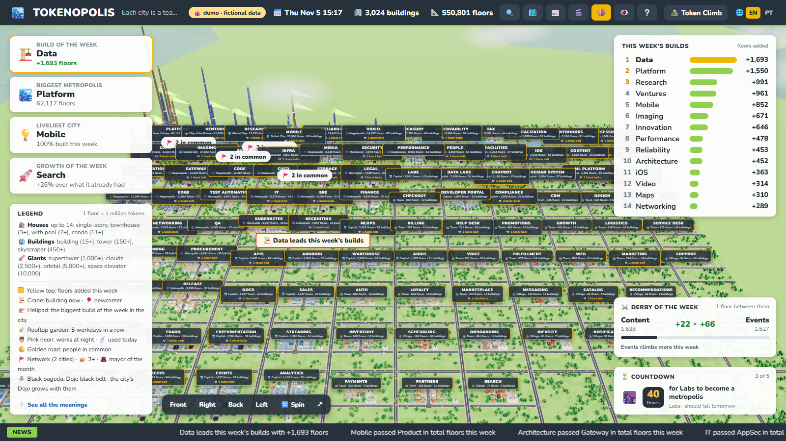
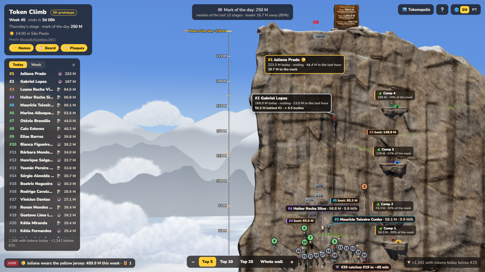

# Tokenopolis

**A living 3D city that grows with your team's AI usage.**

Tokenopolis turns Claude Code token metrics into a game you can leave running on the office TV.
Every team is a city, every person a building, and every million tokens a floor. A second view, the
**Token Climb**, is a daily race up a mountain wall. Both are plain Node + three.js, with no
dependencies and no build step, in English and Brazilian Portuguese.

[Português](README.pt-BR.md) · [Features](docs/features.md) · [Configuration](docs/configuration.md) ·
[Data sources](docs/data-sources.md) · [API](docs/contract.md) · [Deployment](docs/deployment.md) ·
[Changelog](CHANGELOG.md) · [Roadmap](docs/ROADMAP.md)



## Quick start

```bash
git clone https://github.com/lucas-santos-1978/tokenopolis.git
cd tokenopolis
npm run mock
```

Open http://localhost:3000 for the city (generated data), http://localhost:3000/?demo for the
large demo region (a hundred cities, three thousand buildings), and http://localhost:3000/climb.html
for the climb. Add `?lang=pt-BR` for Portuguese, or use the 🌐 switcher in the header. Node 22.15
or newer is required; nothing is installed.

## Feeding it with real data

1. Copy `.env.example` to `.env`.
2. Point it at your data. Out of the box Tokenopolis reads the
   [Claude Code OpenTelemetry metrics](https://docs.anthropic.com/en/docs/claude-code/monitoring-usage)
   from **Datadog** (`DD_ACCESS_TOKEN` or `DD_API_KEY` + `DD_APP_KEY`). Any other system works
   through a **JSON file of daily records** (`DATA_SOURCE=file`) or a **custom module**
   (`DATA_SOURCE=./my-source.js`). See [docs/data-sources.md](docs/data-sources.md).
3. `npm start`.

Optional local files, all ignored by git: `team.json` (who takes part), `nicknames.json` (display
names, avatars, photos), `belts.json` (the belt program). Examples ship next to them.

## What you get

- **The city** (`/`): a 3D region where cities grow from a village to a Mars colony, buildings from a
  house to a space elevator, with monuments for weekly feats, a newspaper, countdowns, a mayor of the
  month, data maps (who is building now, this week's builds, the model each person uses, the belt
  program), a time-lapse since day one and a race of the cities. A tour mode for TVs, a link builder
  for every URL parameter, and a demo region to show it all at once.
- **The climb** (`/climb.html`): the daily stage on a rock wall. Everyone starts at base camp at
  midnight; the day's mark is the median of recent winners; records become plaques on the rock; the
  week's ranking crowns the champion, awards badges and fills a hall of fame. A shareable PNG card.
- **Privacy by design**: the browser only ever receives short ids, names (or anonymized
  "Swift Llama" identities with `ANONYMIZE=true`), floors and timestamps. E-mails and credentials
  never leave the server. The panel can sit behind a password.

The full tour, with the rules of every mechanic, is in [docs/features.md](docs/features.md).



## Configuration at a glance

| Variable | What it does |
|---|---|
| `APP_NAME` | The name shown everywhere (default `Tokenopolis`) |
| `LOCALE` | Default language, `en` or `pt-BR`; visitors can switch |
| `TIMEZONE` | IANA zone for days, weeks and months (default: the host's) |
| `DATA_SOURCE` | `datadog`, `mock`, `demo`, `file` or a module path |
| `CITIES_START`, `CITY_FLOOR_TOKENS`, `CITY_NAMES` | When floors start counting, tokens per floor, team names |
| `SCORE_TYPES`, `MIN_TOKENS`, `TOP_N`, `SEASON_LENGTH` | What counts, who takes part, how the season runs |
| `PANEL_PASSWORD`, `ANONYMIZE`, `ID_SALT` | Access and privacy |

Everything, with defaults, in [docs/configuration.md](docs/configuration.md) and `.env.example`.

## Running it somewhere

`npm start` behind any reverse proxy, or `docker compose up -d` with the included `Dockerfile`.
Details and the author's own VPS scripts in [docs/deployment.md](docs/deployment.md).

## Contributing

Issues and pull requests are welcome; please read [CONTRIBUTING.md](CONTRIBUTING.md) first (no
dependencies, every string through the dictionaries, no real people in the repository).

## License

MIT, see [LICENSE](LICENSE). Third-party assets and their licenses are listed in
[THIRD_PARTY_NOTICES.md](THIRD_PARTY_NOTICES.md).
